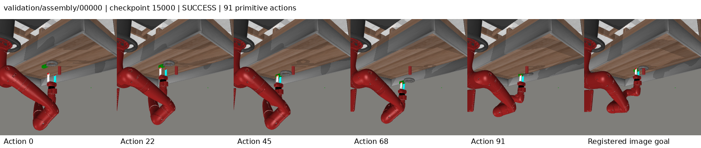
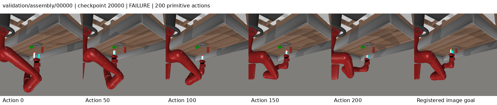
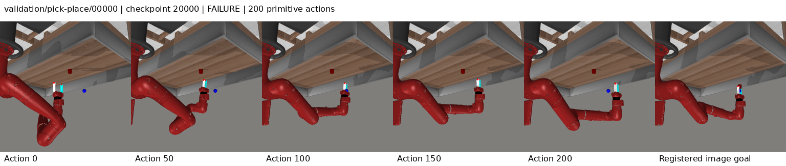

# Execution-calibrated goal progress: completed development result

The selected 15k checkpoint scores **78/104 (75%)**, below the retained 80/104
references. The complete curve is **72 / 72 / 78 / 77**. Adding the goal-progress
readout, soft stage compatibility and causal calibration did not establish a
development improvement. All 416 episodes have zero controller timeouts; the
32/32/26/27 failures exhaust 200 primitive actions. Final tests remain sealed.

One seed 3072 run completed 20,000 updates with the same 6,222 expert episodes,
global batch 64 and eight GPUs. The [CPU final audit](reports/20261011-progress-objective-ttt/analysis/final-audit.json)
passes all 166 runtime hashes, data/bank/checkpoint identities, causal fit and
controller accounting. At 2026-10-12 05:45:43.654942 UTC, [final readback](reports/20261011-progress-objective-ttt/final-health.json)
verified all 44 recorded owned processes absent and [W&B u4dd8tyw](https://wandb.ai/attentionx2023/flow-jepa-metaworld/runs/u4dd8tyw)
finished. No optimizer or evaluation was replayed.

## Fixed development curve and paired results

| Checkpoint | Success | Action-limit failures | Decision latency mean / p95 ms | Repairs selected |
| --- | ---: | ---: | ---: | ---: |
| 5,000 | 72/104 | 32 | 94.14 / 99.90 | 53.04% |
| 10,000 | 72/104 | 32 | 93.54 / 98.01 | 43.25% |
| 15,000 | 78/104 | 26 | 93.24 / 98.61 | 41.48% |
| 20,000 | 77/104 | 27 | 92.65 / 97.70 | 39.90% |

The latency gate used the unchanged 95ms **mean** threshold and passed at 89.523ms;
evaluation p95 values above 95ms are not gate violations. Every episode obeys the
cumulative 10-second controller budget and 200-action limit. Each planning decision
uses 320 world transitions and 12 flow integration steps, with the two-action prefix
and terminal handling unchanged. Surrogate-gradient calls remain zero.

| Task (eight cases each) | 5k | 10k | 15k | 20k |
| --- | ---: | ---: | ---: | ---: |
| assembly | 3 | 1 | 1 | 1 |
| button-press-topdown | 8 | 8 | 8 | 8 |
| coffee-button | 8 | 8 | 8 | 8 |
| dial-turn | 2 | 6 | 8 | 8 |
| door-close | 8 | 8 | 8 | 8 |
| door-open | 7 | 6 | 7 | 7 |
| drawer-close | 8 | 8 | 8 | 8 |
| drawer-open | 8 | 8 | 8 | 8 |
| faucet-open | 2 | 1 | 2 | 4 |
| handle-press | 8 | 8 | 8 | 8 |
| pick-place | 0 | 0 | 1 | 0 |
| plate-slide | 7 | 8 | 8 | 8 |
| reach | 3 | 2 | 3 | 1 |

All comparisons below use selected 15k 78 against each frozen selected reference
on identical case IDs, episode hashes and reset/model seeds. Full winning,
regressing and failed case IDs are in the [saved-record analysis](reports/20261011-progress-objective-ttt/analysis/final-details.json).

| Reference | Reference successes | Wins | Regressions |
| --- | ---: | ---: | ---: |
| guided_ttt | 75 | 4 | 1 |
| progress_ttt | 78 | 4 | 4 |
| flow_reasoning | 79 | 3 | 4 |
| execution_revision | 80 | 3 | 5 |
| controller_grounded | 79 | 6 | 7 |
| leflow_release | 21 | 63 | 6 |
| hwm_paper_port | 5 | 73 | 0 |
| cem_release | 24 | 55 | 1 |
| repair_flow_ttt | 80 | 3 | 5 |
| retrieval_repair_ttt | 80 | 4 | 6 |
| shifted_repair_ttt | 79 | 3 | 4 |

The earlier 5k/10k interim prose interchanged the two 80-reference labels. Saved
paired-record files were correct:5k retrieval 3/11 and execution 5/13;10k retrieval 4/12
and execution 3/11. That prose is corrected here and in the method/history documents;
no outcome, checkpoint or evaluation was changed. All eight comparisons were
recomputed directly from the saved case success flags and matched the JSON files.

Against retrieval-repair 80 there are **4 wins/6 regressions**: gains are dial-turn 7,
faucet 4, reach 0 and reach 2; regressions assembly 1/5/6, door-open 1 and faucet 0/2.
Against execution-revision 80 there are **3 wins/5 regressions**: gains assembly 0,
dial-turn 6 and door-open 0; regressions assembly 5/6/7, faucet 0 and reach 1.
Each shorthand identifies the corresponding zero-padded `validation/task/00000` case.
The 20k model has three gains (assembly 7, faucet 0/1) and four losses (assembly 0,
pick-place 4, reach 0/2) versus selected 15k. Faucet improves 2→4/8, but pick-place
falls 1→0 and reach 3→1/8. Checkpoint selection retains 15k.

## Goal progress, route drift and physical outcomes

The method starts from retrieval-repair, with a spatial goal-conditioned remaining
expert-time readout, separate temporal order loss, soft target-stage penalties
and scalar ridge calibration from past **executed** prefixes. See the
[method, supervision and primary-source distinctions](PROGRESS_OBJECTIVE_TTT.md).
The TRAIN-only no-optimizer 5NN stage diagnostic (95% overall,91.7% pick-place)
was weak expert-stage evidence, not a prediction of physical success. Task IDs
never filter the policy; generated actions never inherit expert outcomes.

| Checkpoint | Raw progress-proxy MAE | Applied correction MAE | Positive optimism penalties / decisions | Selected stage penalty mean |
| --- | ---: | ---: | ---: | ---: |
| 5,000 | 0.020353 | 0.018985 | 3307/5705 | 0.002557 |
| 10,000 | 0.018944 | 0.018513 | 3045/5625 | 0.004108 |
| 15,000 | 0.016240 | 0.016436 | 2769/5181 | 0.003510 |
| 20,000 | 0.016430 | 0.016438 | 2853/5286 | 0.003656 |

These errors use 5601/5521/5077/5182 actually observed prefixes and the correction
actually applied to candidate scores, rather than the separately logged signed
full-correction diagnostic. At selected 15k calibration **slightly worsens** proxy
MAE 0.016240→0.016436; at 20k it is essentially unchanged. The readout itself changes
between checkpoints, so cross-checkpoint MAE is not a fixed physical distance.
Within-checkpoint lower proxy error also cannot establish a controller benefit
without counterfactual physical labels. Score and stage-penalty reconstruction,
episodic reset, bounded correction and fixed past-prefix fit during search pass audit.

Pick-place succeeds 0/0/1/0. At 5k and 10k, all eight failure tails contain only
reach/direct-goal routes. At 15k six of seven failures still do, but failed case 3
uses pick-place routes in all 20 final decisions. At 20k six of eight failures have
reach/direct-only tails; failed cases 1 and 3 retain pick-place routes throughout.
This weakens a route-drift-only explanation: matching route provenance is not
sufficient for success, and the records do not show what rejected routes would
have done. Oracle task-ID filtering is neither justified nor permitted.

Assembly stays 1/8 after 10k; selected assembly 0 succeeds then regresses at 20k.
Faucet 3 fails throughout despite hand motion near the handle. Reach 3 regresses
after 5k and remains unsuccessful. The old target-distance diagnostic flags
15 raw optimistic/stalled selected failures and 5 after correction, versus 21/6
at 20k; these are latent readout signs, not contact, force or physical progress labels.

## Repair use and training diagnostics

| Last 500-update window | Action-flow loss | Deep residual-flow loss | Deep teacher coordinates clipped |
| --- | ---: | ---: | ---: |
| 5,000 | 0.168696 | 0.412216 | 7.25% |
| 10,000 | 0.120192 | 0.291995 | 4.05% |
| 15,000 | 0.090175 | 0.253243 | 3.72% |
| 20,000 | 0.080395 | 0.226365 | 4.07% |

Lower flow losses and generally less teacher clipping do not imply higher physical
success. Teacher interpolation toward recorded actions is not an independent
evaluation of generated actions. All 800 periodic training records, four validation
entries and per-depth windows are preserved, including weak temporal order and
progress-calibration losses. Learned readout optimization is inside the method budget.

| Checkpoint | Generated anchors | Retrieved anchors | Shifted anchors |
| --- | ---: | ---: | ---: |
| 5,000 | 1433 | 1519 | 2753 |
| 10,000 | 1633 | 1442 | 2550 |
| 15,000 | 1513 | 1479 | 2189 |
| 20,000 | 1614 | 1441 | 2231 |

Repairs are used 53.04% at 5k,41.48% at selected 15k and 39.90% at 20k; the unchanged
incumbent remains available and residuals obey the 0.25 bound. This candidate does
not add shifted-anchor training from the preceding shifted variant. It inherits
retrieval-repair's deployment pools; that training/deployment approximation remains.
[Success/failure groups](reports/20261011-progress-objective-ttt/analysis/anchor-outcomes.json)
preserve anchor provenance, selected repairs and stall-feedback counts. They visit
different states and episode lengths and are observational, not component ablations.

Initial global/residual proposal spread contracts 57.77%/47.23% by selected 15k
and 61.76%/51.82% by 20k relative to 5k. The frozen base route costs match across
all 104 resets after subtracting learned stage penalties; total scores may change.
This contraction accompanies both a 72→78 improvement and a 78→77 decline, and also
occurred in improving predecessor runs. It is not proof of a diversity failure.

## Saved visual evidence

All **40** exact contact sheets (ten registered trajectories at each checkpoint)
were opened and visually inspected at 1536×326. Each contains five measured frames
and its registered goal; reset RGB and episode identity are checked by the renderer.
The four `visual-review-*.json` records preserve image hashes, outcomes and observations.
Titles, frame labels and goal panels are complete and readable. No extra model or
simulator call was used. These fixed saved cases do not cover every failed episode.

Pick-place 0 leaves the object on the table while the hand moves toward the goal
region. Faucet 3 has little late visible motion around the handle. Assembly 0 succeeds
at 15k in 91 actions but fails at 20k with the ring near its starting location and hand
motion around it. Reach 3 approaches the goal area but fails after 5k. Single-view
samples do not establish exact 3D contacts, forces, slippage or causal mechanisms.

## Identity, completion and compute

Frozen source `e274fed5850b967c5e8e176e5cab3611d992e8bf`; all 166 runtime files verified.
Manifest `462acfe2a29798ddbe767575dee3c8f338af2ec36096b950b20eb4df4a24f3ac`; protocol `ffdbfce9798ab6beeffd8c99a02d9f95c1b5d2892382567d0ccb0072e76c45d8`;
world `ae3f910da43f0a43dd65945394444a0b11719ed042cdacffacc2faaf824ec5a3`; bank `09e119a78dfbb3c9070ddc1de815517aae8c6e356066be5fa0e136bac310e3d8`.
TRAIN episode identities and bank tensors match the frozen predecessor; no new data.

Server root: `/home/mtxu/adam/LeFlow-experiments/20261011-progress-objective-ttt`.
Checkpoints remain in `campaign/runs/progress_objective_ttt_3072/`.
Selected `best.pt` SHA 256 `953af05eb47d20532978354f8aa3c6513d1fadeda1ff44118736b226cb07b002`;
selected immutable 15k SHA 256 `b19442facd6c514628ea261d0a24a5495f36e9b7cc9ea624dcceb3fe14a98802`;
last SHA 256 `56228591a2a8d2b4096b2d78f7a2f43bd8b588621ed7a606419414edc6f448bf`.
All four milestone tensors/metadata and finite weights were checked; selected tensors
match 15k. Final health records all six checkpoint paths/hashes and 40 saved trajectory
hashes. No model binaries, raw datasets or credentials are committed.

Optimization **4.585255093 GPUh** (16506.918336 GPU-seconds),
evaluation **2.084904452 GPUh**. Stop:20k update limit, zero final-update
overrun, below 28,800 optimization GPU-seconds. Separate preflight/DDP/setup costs:
0.006077854/0.009707458/0.004646322 GPUh.
Training/evaluation wall time 50.532 minutes; final online
logging shutdown follows that marker.46 tests,8-rank finite synchronized-gradient
check and latency gate passed before one fresh optimizer run. The pre-optimizer
full-history transfer recovery and earlier upload-wait snapshot are preserved.

[Known cumulative measured components](reports/20261011-progress-objective-ttt/compute-accounting-final.json)
total **105.284527341 GPUh**, including
65.071588712 optimization and 39.812649347
registered evaluation GPUh. Shared components are counted once. This is not a
complete cluster bill; idle reservations, CPU work, transfers, final logging waits
and unmeasured historical costs are not guessed.

## Comparison limits and next decision

Retain 80/104. One seed, repeatedly reused development cases, selected checkpoints,
different four/eight-rank random streams, custom baseline ports and matched ceilings
rather than equal consumed compute establish neither generalization, component
causality, novelty nor native-author-benchmark SOTA. The progress readout is an
adaptation and hypothesis, not a faithful reproduction of a complete primary method.

Publish and remotely verify this complete negative result before a further decision.
No next candidate is registered or queued. Remaining weak supervision, shifted-plan
coverage, route weighting and proposal spread are possible limitations, not proven
causes that automatically authorize another variant.
