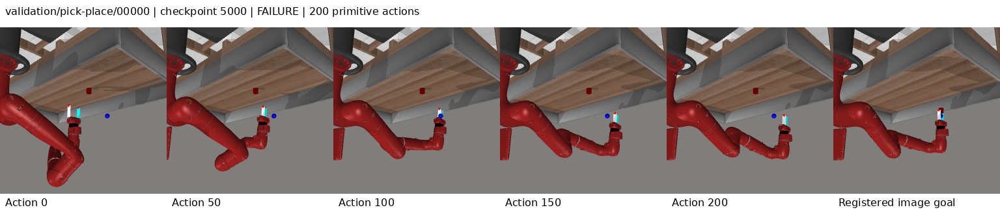
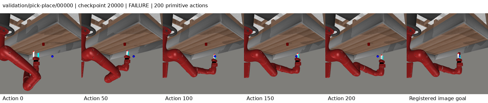

# Repair-flow TTT: completed development result

The selected 5k checkpoint scores **80/104 (76.92%)**, tying the preserved execution-revision GMM controller with **six paired wins and six regressions**. The complete curve is **80 / 73 / 75 / 75**. The final 20k checkpoint is worse than the selected model. There is no development improvement over 80, no causal repair/TTT gain established, and no sealed-test result.

One fresh seed 3072 run completed 20,000 updates on four GPUs, global 64, using the same 6,222 successful expert episodes and frozen world. All four registered 104-case evaluations completed; W&B [r3y7nepq](https://wandb.ai/attentionx2023/flow-jepa-metaworld/runs/r3y7nepq) is finished and all owned processes exited. [Final health](reports/20261011-repair-flow-ttt/final-health.json) and [source/data/checkpoint audit](reports/20261011-repair-flow-ttt/analysis/final-audit.json) preserve the verification.

## Full curve and operational failures

| Checkpoint | Successes | Timeouts | Mean decision ms | Repair selected | Corrected prefix MAE |
| --- | ---: | ---: | ---: | ---: | ---: |
| 5,000 | 80/104 | 0 | 86.46 | 55.85% | 0.0016883 |
| 10,000 | 73/104 | 0 | 86.27 | 49.92% | 0.0016801 |
| 15,000 | 75/104 | 0 | 86.49 | 47.19% | 0.0015944 |
| 20,000 | 75/104 | 0 | 86.46 | 47.41% | 0.0016023 |

There are zero controller timeouts in all 416 evaluations. All 24 selected-model failures and all 29 final-model failures reach the 200-primitive-action ceiling. Zero surrogate-gradient evaluations are recorded; the controller retains the registered 320 world transitions and 12 flow integration steps per decision. Removing guidance does not by itself establish why the earlier guided run timed out or why this one differs in success.

| Task (eight cases each) | 5k | 10k | 15k | 20k |
| --- | ---: | ---: | ---: | ---: |
| assembly | 1 | 0 | 1 | 1 |
| button-press-topdown | 8 | 8 | 8 | 8 |
| coffee-button | 8 | 8 | 8 | 8 |
| dial-turn | 7 | 7 | 8 | 8 |
| door-close | 8 | 8 | 8 | 8 |
| door-open | 8 | 7 | 6 | 6 |
| drawer-close | 8 | 8 | 8 | 8 |
| drawer-open | 8 | 8 | 8 | 8 |
| faucet-open | 2 | 0 | 1 | 1 |
| handle-press | 8 | 8 | 8 | 8 |
| pick-place | 2 | 0 | 0 | 0 |
| plate-slide | 8 | 8 | 8 | 8 |
| reach | 4 | 3 | 3 | 3 |

All cases are development cases in seen tasks. No held-out-task or final-test generalization result is available. Full reports preserve every reset ID, success, failure, action count, controller time, and per-decision diagnostic; losses are not substituted for task success.

## Paired reference comparisons

| Frozen reference | Reference successes | Repair wins | Repair regressions |
| --- | ---: | ---: | ---: |
| guided_ttt | 75 | 7 | 2 |
| progress_ttt | 78 | 7 | 5 |
| flow_reasoning | 79 | 4 | 3 |
| execution_revision | 80 | 6 | 6 |
| controller_grounded | 79 | 8 | 7 |
| leflow_release | 21 | 64 | 5 |
| hwm_paper_port | 5 | 75 | 0 |
| cem_release | 24 | 57 | 1 |

These are selected checkpoint comparisons on repeatedly reused development cases, not independent test estimates. The current common-world released CEM reference is 24/104. Historical different-world CEM7/104 and the new-world 20k diagnostic22/104 remain documented in earlier campaign reports and are not pooled into this table. LeFlow release-module/spatial and HWM paper ports retain their documented reproduction/adaptation limitations. Matched ceilings do not mean equal consumed compute; four-rank training here also changes random-stream assignment relative to earlier eight-rank runs.

Against GMM80, repair wins dial-turn6, door-open0/1, faucet-open1, pick-place3 and reach7. It loses assembly6/7, dial-turn2, faucet-open0/7 and reach1. The [complete paired inventory](reports/20261011-repair-flow-ttt/analysis-round-4.json) keeps exact case IDs and source hashes for every reference. A single seed and 104 selected development cases cannot establish reliable superiority, training-seed uncertainty, component causality or publication readiness.

## What the repairs actually did

At 5k the repair pool supplies 2,889/5,173 decisions (55.85%); the exact incumbent supplies the rest. Selected repair changes have mean L-infinity norm .110684 and maximum .25000003, within the .25 limit up to FP32 roundoff. Corrected executed-prefix MAE is .0016883 versus prior.0026366, a35.97% reduction. Fifteen of 24 failures have optimistically scored, nonpositive observed latent-progress tails under raw scores; five remain optimistic after correction. These are latent progress proxies, not physical reward/contact measurements.

Repairs remain selected 47.41% of the time at 20k, yet success is 75/104. Corrected MAE decreases to .0016023, but nineteen of 29 failures still have raw optimistic tails and eight corrected optimistic tails. Observationally selected repairs and incumbents visit different states; comparing their average progress is not a causal repair ablation.

For the last500 updates before each milestone, deep-update teacher clipping falls 7.79% →3.81% →3.23% →2.78%; deep repair-flow loss falls .4393 →.3341 →.2743 →.2349. Anchor action MSE falls .02870 →.01563 →.01348 →.01113. Teacher-interpolated action MSE also falls .01841 →.00976 →.00883 →.00770. This teacher branch contains the recorded target and is not a sample-quality metric. Better action/flow losses and prefix calibration did not predict better task success. Shallow/deep logs are preserved separately so zero repair loss on shallow updates cannot be mistaken for improvement.

At identical initial reset/goal pairs, empty histories and matched routes, global proposal dispersion falls 61.94% from 5k to 20k and the residual pool57.30%, on all 104 cases. These finite candidate-pool statistics are not policy entropy and do not prove collapse caused the failures. An identified implementation mismatch remains: offline residual anchors come from generated proposals, while deployment may choose retrieved or shifted plans. Whether this explains the remaining failures requires a specific causal/data-aligned correction and verification; no extra evaluation was run for this report.

## Saved visual evidence

All ten selected 5k and all ten final 20k contact sheets were visually inspected at 1536×326, including successful cases. Frames are uniformly sampled from already saved registered episodes and paired with the registered goal; their first frames were checked against the saved initial RGB. No simulator, new policy rollout or test case was opened for this review. [5k inspection](reports/20261011-repair-flow-ttt/visual-review-5000.json), [20k inspection](reports/20261011-repair-flow-ttt/visual-review-20000.json).

Pick-place0 leaves the red object on the table while the hand moves toward the goal-marker region at both checkpoints. Faucet3 and reach3 show little late visible change and remain unsuccessful. Assembly0 approaches and withdraws around the ring/peg region without achieving the registered assembly criterion. Single-view images do not measure contact forces, precise3D distances or physical causes; these ten fixed illustrations do not cover every failure.

## Identity, compute and preservation

Frozen source: `481bb7679aa3f43e938fd3991f3be57ba59f0ed0`. All 150 runtime hashes and clean tracked source passed the final audit. Manifest `135dd863aa64b200b85a3ec075e721d8991dda4ebc4d940002efd396412012cc`; world `ae3f910da43f0a43dd65945394444a0b11719ed042cdacffacc2faaf824ec5a3`; bank `8008e20a5ec241c03bcc2da0b18025e21fb9b97793afdc5d57abe4cf4f4a1e48`. The bank tensors, TRAIN episode identities, causal history, memory reset, score reconstruction and matched validation cases passed checks.

Server root: `/home/mtxu/adam/LeFlow-experiments/20261011-repair-flow-ttt`. Checkpoints remain under `campaign/runs/repair_flow_ttt_3072/`. Selected `best.pt` SHA256 `bba02692caba66aacef7c1301f9015a9fdfec0e9f69cb530946eb77e0636729d`; final `last.pt` SHA256 `f6f569f591923184b73ce0d74fd13a82d42360c8cdb970e2caaf526e9a9c14cc`. All four immutable checkpoint paths/hashes are in final-health.json; selected model tensors match5k. No model binaries, credentials or raw dataset are committed.

Optimization **1.619592 GPUh**, registered validation **1.815225 GPUh**, zero last-update overrun; the 20k-update ceiling ends training below the 8 optimization-GPUh ceiling. Train-only preflight .005795 GPUh, no-update DDP check .002990 GPUh and both saved diagnostic attempts .000945 GPUh are retained separately. Trainer wall time52.19 minutes; coordinator54.61 minutes includes setup. There are800 full periodic training records and four validation records, losslessly compressed alongside all four complete evaluation reports.

Known cumulative measured campaign components now total **90.934490 GPUh**, including **56.504701 optimization GPUh** and **34.075390 validation GPUh**. [Compute accounting](reports/20261011-repair-flow-ttt/compute-accounting.json) preserves sources, prior campaigns, diagnostics and shared-adapter deduplication; it is not a full infrastructure bill. Baselines, older checkpoints and sealed tests remain untouched.

## Decision

Preserve80/104 as a tied development reference. Publish this complete negative/neutral result before considering one evidence-backed next correction under the existing sequential authorization. No further candidate is dispatched by this completion report. Repeated development-case optimization does not establish generalization or novelty.
