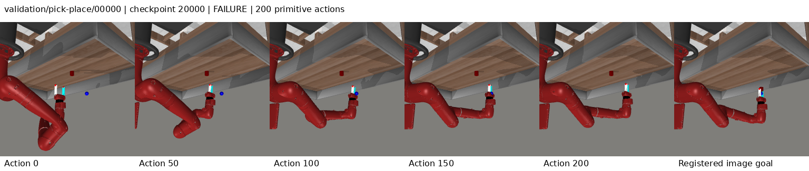

# Retrieval-conditioned repair: completed development result

The final 20k checkpoint scores **80/104 (76.92%)**, tying both the preserved
execution-revision and repair-flow references. The complete curve is
**75 / 77 / 79 / 80**. There is no improvement over the preserved best and no
sealed-test result. Against repair-flow80, the selected model has
**7 paired wins and 7 regressions**; against execution-revision80,
**6 wins and 6 regressions**.

One fresh seed3072 candidate completed 20,000 updates on four GPUs with global
batch64, the unchanged 6,222 successful expert episodes, frozen encoder/world
and all four fixed104 development evaluations. W&B
[6wpx3jcv](https://wandb.ai/attentionx2023/flow-jepa-metaworld/runs/6wpx3jcv) is finished;
all recorded owned processes exited. [Final health](reports/20261011-retrieval-repair-ttt/final-health.json)
and the [CPU audit](reports/20261011-retrieval-repair-ttt/analysis/final-audit.json)
verify source/data/bank/checkpoint identity, causal history, episodic reset and
controller/optimization accounting. No model or simulator was called for analysis.

## Complete curve and failures

| Checkpoint | Successes | Timeouts | Mean decision ms | Repair selected | Corrected prefix MAE |
| --- | ---: | ---: | ---: | ---: | ---: |
| 5,000 | 75/104 | 0 | 85.65 | 53.37% | 0.0015608 |
| 10,000 | 77/104 | 0 | 85.68 | 44.21% | 0.0016705 |
| 15,000 | 79/104 | 0 | 85.62 | 45.88% | 0.0016449 |
| 20,000 | 80/104 | 0 | 85.72 | 43.63% | 0.0016236 |

All 416 episodes have zero controller timeouts. The 29/27/25/24 failures at
5k/10k/15k/20k all reach the 200-primitive-action ceiling. Each decision preserves
320 world transitions, 12 flow integration steps, two primitive actions per
prefix (or one on terminal success), and the cumulative 10-second controller
allowance. Residual changes stay within .25 up to FP32 roundoff; the exact
incumbent remains available. No surrogate-gradient calls are made.

| Task (eight cases each) | 5k | 10k | 15k | 20k |
| --- | ---: | ---: | ---: | ---: |
| assembly | 3 | 1 | 3 | 4 |
| button-press-topdown | 8 | 8 | 8 | 8 |
| coffee-button | 8 | 8 | 8 | 8 |
| dial-turn | 8 | 6 | 8 | 7 |
| door-close | 7 | 8 | 8 | 8 |
| door-open | 7 | 7 | 7 | 8 |
| drawer-close | 8 | 8 | 8 | 8 |
| drawer-open | 8 | 8 | 8 | 8 |
| faucet-open | 0 | 2 | 3 | 3 |
| handle-press | 8 | 8 | 8 | 8 |
| pick-place | 1 | 1 | 1 | 1 |
| plate-slide | 8 | 8 | 8 | 8 |
| reach | 1 | 4 | 1 | 1 |

All cases are reused development cases in seen tasks. There is no held-out-task
or final-test generalization estimate. Every case ID, reset seed, episode hash,
action count, controller time, failure and per-decision trace is preserved in
the [full losslessly compressed records](reports/20261011-retrieval-repair-ttt/run/validation).

## Paired comparisons

| Frozen reference | Reference successes | Current wins | Current regressions |
| --- | ---: | ---: | ---: |
| guided_ttt | 75 | 9 | 4 |
| progress_ttt | 78 | 7 | 5 |
| flow_reasoning | 79 | 8 | 7 |
| execution_revision | 80 | 6 | 6 |
| controller_grounded | 79 | 7 | 6 |
| leflow_release | 21 | 64 | 5 |
| hwm_paper_port | 5 | 75 | 0 |
| cem_release | 24 | 57 | 1 |
| repair_flow_ttt | 80 | 7 | 7 |

The [paired inventory](reports/20261011-retrieval-repair-ttt/analysis-round-4.json)
contains every gained/lost case and reference-file hash. Cases, data and common
world are matched to these reported references; consumed compute is not equal.
Earlier historical implementations with other worlds/representations remain
separate. Current released CEM24 is not pooled with historical CEM7 or the
previous new-world diagnostic22. LeFlow release-module/spatial and HWM paper
ports retain their documented adaptation limitations. Four-rank training also
changes random-stream assignment relative to earlier eight-rank runs.

These are selected, single-seed development comparisons. Repeated tuning and
checkpoint selection prevent independent generalization or definitive superiority
claims; case-paired uncertainty would not measure training-seed variation. This
comparison does not isolate the causal contribution of retrieval, repair or TTT.

## Did the correction address its intended training gap?

The candidate replaces one generated training proposal with a route retrieved
from another training episode, excluding the entire query episode before both
shortlisting and reranking. It changes training evidence, while deployment
computation and architecture remain unchanged. The retrieved action is selected
as the teacher's repair anchor on a substantial fraction of deep-update examples:

| Milestone window | Deep repair loss | Clipped residual coordinates | Anchor action MSE | Teacher-interpolated MSE | Retrieved training anchor |
| --- | ---: | ---: | ---: | ---: | ---: |
| 5,000 | 0.427065 | 6.87% | 0.032702 | 0.021947 | 30.94% |
| 10,000 | 0.291928 | 4.06% | 0.020810 | 0.014172 | 30.16% |
| 15,000 | 0.240611 | 3.81% | 0.018654 | 0.012353 | 26.72% |
| 20,000 | 0.232398 | 3.87% | 0.022972 | 0.015907 | 28.44% |

Windows cover the last500 updates before each checkpoint, separated by shallow
and deep updates. Clipping measures the fraction of residual action coordinates
outside the .25 teacher bound, not the fraction of episodes. Teacher estimates
contain the recorded target action; their MSE improvement is not a generated
sample-quality measurement. Recorded outcome labels remain attached only to
their recorded actions. The frozen model's scores on other actions are proxies.

| Checkpoint | Generated repair anchors | Retrieved anchors | Shifted anchors |
| --- | ---: | ---: | ---: |
| 5,000 | 1,586 | 1,482 | 2,484 |
| 10,000 | 1,495 | 1,394 | 2,313 |
| 15,000 | 1,439 | 1,461 | 2,307 |
| 20,000 | 1,548 | 1,375 | 2,264 |

These counts record incumbent provenance before residual repair. The selected
20k model chooses repairs for 43.63% of 5,187 decisions. Group frequencies
are observational: different actions lead to different states and episode
lengths. The new training slot does not cover shifted prior plans, which remain
common deployment anchors. This is a confirmed remaining implementation gap,
not proof that it caused any physical failure.

Corrected prefix error is not a consistent success predictor: it rises between
5k and10k while success rises, and at20k is 0.0016236 versus prior
0.0023497. Raw scores have optimistic, nonpositive-observed latent-progress
tails in 16/24 final failures; corrected scores do so in
7/24. Neither latent progress nor a score improvement measures physical
contact quality. Between5k and20k, initial global proposal spread falls
62.03% and residual-pool spread 51.25% on the identical104 resets while
success rises from75 to80. Candidate spread is not policy entropy, and the
observed pattern does not establish a causal collapse explanation.

## Saved visual review

All ten 15k contact sheets and all ten selected/final20k contact sheets were
visually inspected at1536×326, including successes. Each contains five uniformly
sampled saved rollout frames and its registered goal; first frames were checked
against the cached initial RGB. [15k review](reports/20261011-retrieval-repair-ttt/visual-review-15000.json),
[20k review](reports/20261011-retrieval-repair-ttt/visual-review-20000.json).

The selected pick-place0 example leaves the object on the table in late frames
while the hand moves toward the goal region. Faucet3 and reach3 exhibit little
late visible change and remain unsuccessful. Single-view images do not establish
contact forces, precise3D errors or causal failure mechanisms, and these fixed
illustrations do not cover every failure.

## Source, checkpoints and actual compute

Frozen source `3bdfb49e7c9d4952da7494e50c8dc2530197641e` and all137 runtime hashes
passed. Manifest `77272fbe04eed6af8e6c8717252bdd6c58bcad0e431546290528725f4f6517e8`;
world `ae3f910da43f0a43dd65945394444a0b11719ed042cdacffacc2faaf824ec5a3`;
route bank `268dd6eb6f406aa9036ecd0aa3ac5a552f2d41d5a819598c2f2b6638814c67e1`.
The bank's TRAIN episode IDs/hashes and tensors match its preserved predecessor;
data statistics and reset identities are unchanged.

Server record: `/home/mtxu/adam/LeFlow-experiments/20261011-retrieval-repair-ttt`.
Checkpoint files remain under `campaign/runs/retrieval_repair_ttt_3072/`.
Selected `best.pt` SHA256 `1a4f6f69b57e0bf009b9fc3731c642aa4ffd01d12275a34969b32a2222609532`;
`last.pt` SHA256 `870fd1e01ae27486ce0b771c50a73823899dec531bc30531cedb3319558a6b42`. Selected model tensors
match the immutable20k milestone. All four milestone paths/hashes and saved
trajectory hashes are recorded in final-health.json. Model binaries, credentials
and raw datasets are excluded from Git.

Actual optimization **1.748656 GPUh**, registered evaluation
**1.834349 GPUh**, zero last-update overrun. The20k ceiling ended training
below the8 optimization-GPUh ceiling. Preflight0.005975, no-update distributed
check0.004537, and retrieval setup0.002283 GPUh are retained separately;
per-update retrieval is included inside optimization. Training/evaluation wall
time is54.43 minutes. All800 periodic training entries and all four
validation metric entries are preserved losslessly alongside every full report.

[Known cumulative measured components](reports/20261011-retrieval-repair-ttt/compute-accounting.json)
now total **94.530290 GPUh**, including **58.253357 optimization**
and **35.909739 registered validation GPUh**. This is not a full
cluster bill; unmeasured historical costs, CPU analysis and idle reservations
are not guessed. Shared components are counted once; per-run charged ceilings
are preserved.

## Decision

Preserve this neutral result and the80/104 reference. The intended retrieved-anchor
training mismatch is addressed in code and observable training diagnostics, but
there is no development gain over the best references. Publish the complete
record before considering one further supported correction. The remaining
shifted-anchor coverage gap warrants analysis under the authorized sequential
loop, without claiming that fixing it will improve success. No further candidate
is launched by this result publication; baselines and sealed tests remain untouched.
