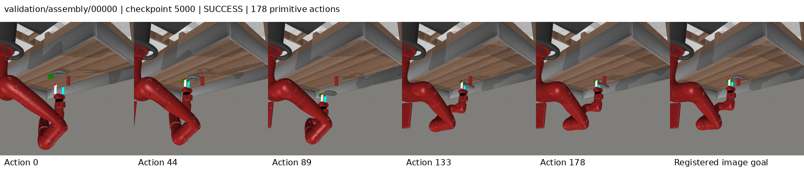
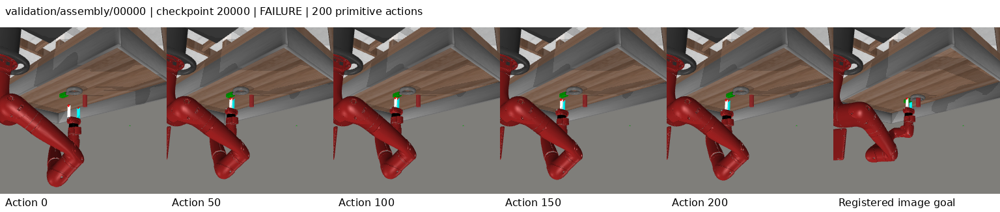
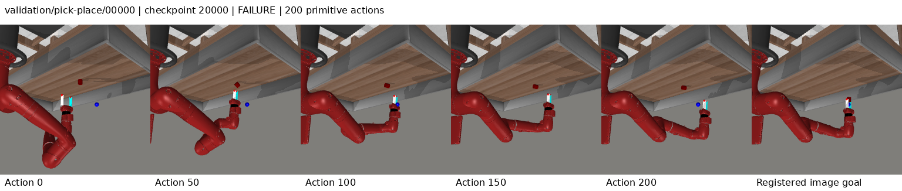

# Shifted-plan repair: completed development result

The selected 5k checkpoint scores **79/104 (75.96%)**, below the preserved
80/104 references. The complete curve is **79 / 78 / 74 / 78**; the final 20k
checkpoint scores 78. There are zero timeouts across all 416 episodes. This
correction does not establish an improvement. Final tests remain sealed.

One seed 3072 run completed 20,000 updates on four GPUs with global batch 64,
the same 6,222 successful expert episodes and four fixed 104 development rounds.
The source/data/checkpoint [CPU audit](reports/20261011-shifted-repair-ttt/analysis/final-audit.json)
passes. [W&B 8yy6nh9f](https://wandb.ai/attentionx2023/flow-jepa-metaworld/runs/8yy6nh9f)
finished and all 23 recorded owned processes exited, verified in the
[final lifecycle readback](reports/20261011-shifted-repair-ttt/completion-lifecycle-final.json).
The earlier upload-wait snapshots remain preserved as operational evidence.

## Curve, stopping reasons and paired failures

| Checkpoint | Successes | Timeouts | Mean decision ms | Repairs chosen | Corrected prefix MAE |
| --- | ---: | ---: | ---: | ---: | ---: |
| 5,000 | 79/104 | 0 | 85.74 | 49.68% | 0.0016209 |
| 10,000 | 78/104 | 0 | 84.94 | 43.72% | 0.0015998 |
| 15,000 | 74/104 | 0 | 84.57 | 43.59% | 0.0016547 |
| 20,000 | 78/104 | 0 | 84.57 | 41.26% | 0.0016202 |

The 25/26/30/26 failures all reach 200 primitive actions. Each decision retains
320 world transitions, 12 flow integration steps, a two-action execution prefix
(or one on terminal success), and the cumulative 10-second controller allowance.
The bounded residual is at most .25 up to FP32 roundoff; the exact incumbent
remains available. No surrogate-gradient calls or final-test evaluations occur.

| Task (eight cases each) | 5k | 10k | 15k | 20k |
| --- | ---: | ---: | ---: | ---: |
| assembly | 3 | 3 | 0 | 3 |
| button-press-topdown | 8 | 8 | 8 | 8 |
| coffee-button | 8 | 8 | 8 | 8 |
| dial-turn | 7 | 7 | 8 | 8 |
| door-close | 8 | 8 | 8 | 8 |
| door-open | 7 | 6 | 7 | 7 |
| drawer-close | 8 | 8 | 8 | 8 |
| drawer-open | 8 | 8 | 8 | 8 |
| faucet-open | 1 | 2 | 1 | 1 |
| handle-press | 8 | 8 | 8 | 8 |
| pick-place | 1 | 1 | 1 | 1 |
| plate-slide | 8 | 8 | 8 | 8 |
| reach | 4 | 3 | 1 | 2 |

Paired comparisons below use the **selected 5k79** and each frozen reference's
selected checkpoint on identical case/reset/model-seed/episode-hash identities.
The [full analysis](reports/20261011-shifted-repair-ttt/analysis-round-4.json)
contains every winning/regressing/failed case ID, not only aggregate scores.

| Reference | Reference successes | Selected model wins | Selected model regressions |
| --- | ---: | ---: | ---: |
| guided_ttt | 75 | 7 | 3 |
| progress_ttt | 78 | 7 | 6 |
| flow_reasoning | 79 | 6 | 6 |
| execution_revision | 80 | 5 | 6 |
| controller_grounded | 79 | 8 | 8 |
| leflow_release | 21 | 63 | 5 |
| hwm_paper_port | 5 | 74 | 0 |
| cem_release | 24 | 56 | 1 |
| repair_flow_ttt | 80 | 4 | 5 |
| retrieval_repair_ttt | 80 | 6 | 7 |

Final 20k versus selected 5k has six wins and seven regressions. Gains are
assembly/00006, assembly/00007, dial-turn/00006, door-open/00005,
faucet-open/00000 and reach/00004. Regressions are assembly/00000,
assembly/00005, door-open/00001, faucet-open/00004, reach/00000,
reach/00002 and reach/00003; all carry the `validation/` prefix.
Reach falls from 4/8 to 2/8; faucet-open and pick-place stay 1/8.

## Intended correction and observed use

Training now synthesizes a previous plan from recorded information ending at
t−1, shifts its remaining four blocks, and retains a fresh final block. Previous
retrieval excludes the query episode. Current observations, action labels and
outcomes are not exposed to the previous planner. The architecture and deployment
controller are unchanged. See the [method and primary-source distinctions](SHIFTED_REPAIR_TTT.md).

| Last 500-update window | Deep repair loss | Clipped teacher coordinates | Deep calibration loss | Shift eligible | Shift chosen |
| --- | ---: | ---: | ---: | ---: | ---: |
| 5,000 | 0.423991 | 7.57% | 0.027099 | 98.28% | 54.84% |
| 10,000 | 0.290391 | 4.52% | 0.025243 | 95.62% | 52.03% |
| 15,000 | 0.253010 | 4.38% | 0.024627 | 96.41% | 57.66% |
| 20,000 | 0.240051 | 4.52% | 0.025476 | 97.03% | 57.19% |

The shifted path is eligible and chosen substantially, so a zero-use bug does
not explain the result. Shallow updates intentionally omit it. Teacher clipping
is a coordinate fraction, not an episode failure rate. Final deep anchor/teacher
action MSE is .032337/.021552. The teacher interpolates toward the recorded target;
its lower error is not independent evidence of executable sample quality.

| Checkpoint | Generated incumbent anchors | Retrieved anchors | Shifted anchors |
| --- | ---: | ---: | ---: |
| 5,000 | 1,487 | 1,319 | 2,490 |
| 10,000 | 1,592 | 1,405 | 2,209 |
| 15,000 | 1,468 | 1,565 | 2,464 |
| 20,000 | 1,489 | 1,464 | 2,248 |

Repairs are chosen in 49.68% of selected 5k decisions and 41.26% at 20k. These groups
visit different states and have different episode lengths; their frequencies are
not randomized component comparisons. [Final anchor/outcome records](reports/20261011-shifted-repair-ttt/anchor-outcomes-round-4.json)
preserve provenance, stall counts and action-limit case IDs.

Lower repair loss and reduced teacher clipping do not predict higher success.
Corrected deployed prefix MAE improves at 10k and returns near its 5k value at 20k,
while success 79→78→74→78. Raw optimistic/nonpositive-observed latent tails occur
in 19/25 selected failures and 16/26 final failures; corrected tails in 12/25 and 8/26.
These latent diagnostics do not establish contact forces or physical progress.
Initial global proposal spread decreases 62.75% and residual spread
50.99% from 5k to 20k, on all 104 matched resets with empty history.
This is not likelihood entropy or proof of collapse causing failure: the preceding
retrieval run also contracted while improving 75→80.

## Saved visual review

All ten selected 5k and all ten final 20k contact sheets were visually inspected
at 1536×326: five saved rollout frames plus the registered goal, with initial RGB
checked against the cached reset. [Selected review](reports/20261011-shifted-repair-ttt/visual-review-5000.json)
and [final review](reports/20261011-shifted-repair-ttt/visual-review-20000.json)
record image hashes, observations and limits. Labels are readable without clipping.

Assembly 0 moves the ring toward the goal at 5k (success at 178 actions); its 20k
regression approaches the ring and exhibits little late visible change before
200 actions. Reach 3 succeeds at 5k but has a visually offset, nearly stationary
late hand position at 20k. Pick-place 0 leaves the cube on the table while the hand
moves toward the goal region. Faucet 3 also shows little late visible change.
Single-view images cannot establish exact 3D contact, forces or a causal failure
mechanism; these ten fixed illustrative cases do not cover every failed case.

## Identity and actual compute

Frozen source `2ae5a6c97bebe56b0b1f889cb34996d34cbf03d6` and all 146 runtime hashes pass. Manifest
`630452762a9be73da3d3dca9d77deb573c363519f5f974f566b325e6031084d2`; world `ae3f910da43f0a43dd65945394444a0b11719ed042cdacffacc2faaf824ec5a3`;
bank `d9a45fd33cbf09e88fd6200f3a807fe95df3a74b97478dc497f80d758b6a9b5b`. TRAIN episode IDs/hashes and route-bank tensors
match the predecessor; data statistics/reset identities are unchanged.

Server record: `/home/mtxu/adam/LeFlow-experiments/20261011-shifted-repair-ttt`. Checkpoints remain under
`campaign/runs/shifted_repair_ttt_3072/`. Selected `best.pt` SHA256
`1ef1471b6a1a23ab01fb75890ef8dc1d81f341a74d1cf2e0c8a9501f25a01ad9`; last SHA256
`a448da06a5ea346a0cd0fc2d7d55ee995075047f21a1d516036541b08b378774`. Selected tensors match the immutable 5k
milestone. [Final health](reports/20261011-shifted-repair-ttt/final-health.json)
records all four checkpoint paths/hashes and 40 saved trajectory hashes.
No raw datasets, model binaries or credentials are committed.

Optimization **2.232976 GPUh**, registered evaluation
**1.818006 GPUh**, zero last-update overrun. Training
stopped at 20k updates below the 8 optimization-GPUh limit. Preflight
0.005931, no-update DDP 0.004606, and retrieval
setup 0.002128 GPUh are separate. Previous planning and per-update
retrieval are charged inside optimization. Training/evaluation wall time is
61.47 minutes, excluding final logging shutdown.
All 800 periodic metrics and four validation entries, all reports and negative
results are preserved losslessly.

[Known cumulative measured components](reports/20261011-shifted-repair-ttt/compute-accounting-final.json)
total **98.593936 GPUh**, including
60.486334 optimization and 37.727745
registered validation GPUh. Shared components are counted once. This is not a
complete cluster bill; idle reservations, CPU work, final upload waits and
unmeasured historical costs are not guessed. Launch/interim compute snapshots
remain intact alongside the final account.

## Limits and decision

Retain the 80/104 reference. Covering this shifted-plan training path did not
improve the selected development result. The offline approximation still pairs
expert current states with prior generated plans, holds the prior target equal,
and omits recursive warm-start and prior multi-target/stall selection. These
are known approximations, not demonstrated causes or automatically justified
new candidates. Recorded physical outcomes remain attached only to recorded
actions; other scores are model proxies.

One seed, repeatedly reused development cases, checkpoint selection, differing
four/eight-rank random streams, baseline ports and matched ceilings rather than
equal consumed compute prevent generalization, component causality or SOTA
claims. Completion was remotely verified at aab136e. The
[post-publication review](SHIFTED_REPAIR_TTT_REVIEW.md) holds further launches
because no specific supported correction remains at this review. No baseline
retraining or sealed-test work is permitted.
